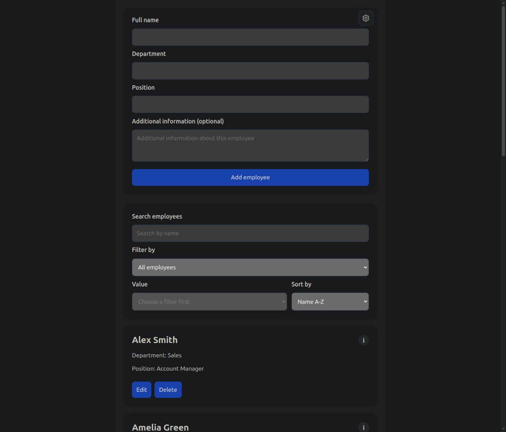

# Employee Management

[View the live demo](https://r0bby97.github.io/employee-management/)

This browser application was developed as part of my JavaScript project at velpTEC. It lets users add, search, filter, sort, edit and delete employees. The project uses HTML, CSS and vanilla JavaScript without frameworks or a backend.

## Preview



## Getting Started

1. Open the project folder in Visual Studio Code.
2. Start `index.html` using Live Preview or Live Server.
3. Open the application in your browser.

Alternatively, if Python is installed, start a local server from the project folder:

```bash
python3 -m http.server 8000
```

The application is then available at [http://localhost:8000](http://localhost:8000). This project does not require npm packages or a build step.

## Features

- **Employee management:** Enter a name, department and position, with an optional note. Edit existing records in a dialog or delete them directly.
- **Live search:** Search employees by name as you type. Search is case-insensitive.
- **Filters:** Narrow down results by department or position. Filter options are generated from the employee data and updated when records change.
- **Sorting:** Sort by name, department or position in ascending or descending alphabetical order. The default is Name A-Z.
- **Infinite scrolling:** An `IntersectionObserver` watches a sentinel below the list. Up to ten more entries are displayed at a time as you scroll.
- **Tooltips:** Employees with a note have an info button. Notes appear on hover or keyboard focus and can be dismissed with Escape.
- **Local storage:** Employee data and the selected light or dark theme are preserved across page reloads.
- **JSON export and import:** Back up all employees as JSON and restore them through the settings menu. Imports replace the current list only after validation and storage succeed.
- **Data reset:** A confirmation dialog helps prevent accidental resets. After confirmation, the list stays empty across reloads while the selected theme is preserved.
- **Responsive layout:** The form, filters and employee cards adapt to smaller screens.

Search, filters and sorting can be combined. They apply to the entire result set before the next batch is displayed.

## Using the Application

Add employees through the form. **Edit** opens the editing dialog, and **Save** stores the changes. **Cancel** or Escape closes the dialog without saving. **Delete** removes the selected employee immediately.

The gear button in the top-right corner of the form opens the settings menu. It contains **Export as JSON**, **Import from JSON**, the theme switch and **Reset data**. Importing replaces the existing employee list rather than adding to it.

The application starts with 100 sample records on first use. After a reset, restore them by selecting **Import from JSON** and choosing `employees-beispieldaten.json`.

## Data Format and Validation

A JSON file contains an array of employee objects:

```json
[
  {
    "id": 1,
    "name": "Jan Meyer",
    "department": "IT",
    "position": "Frontend Developer",
    "notes": "Contact person for the internal website."
  }
]
```

| Field | Requirement |
| --- | --- |
| `id` | Unique positive integer |
| `name` | Required, up to 100 characters |
| `department` | Required, up to 80 characters |
| `position` | Required, up to 100 characters |
| `notes` | Text with up to 500 characters; an empty string is allowed |

Names may contain Latin letters A-Z, German umlauts and the German sharp S, spaces, hyphens and apostrophes. At least one letter is required. Numbers and periods are not allowed.

Form inputs are trimmed and validated before saving. Errors appear in the form, dialog or list area. Invalid stored records are excluded when processing the list. Imports containing invalid records or duplicate IDs are rejected entirely. If saving an addition, edit or deletion fails, the existing employee data remains unchanged.

## Browser Storage

The application uses these `localStorage` keys:

| Key | Contents |
| --- | --- |
| `employees` | Saved employee list as JSON |
| `theme` | Selected theme: `light` or `dark` |
| `employeesReset` | Marker that prevents sample records from returning after a reset |

**Reset data** removes the `employees` entry and clears the current list. The reset marker and theme preference remain stored. Sample records in the source code and JSON file remain available as a template.

Data is stored in the current browser for the origin used to open the application, including its port. Opening a different address can therefore show a different storage state. Use JSON export to keep a separate backup.

## Project Structure

```text
Projektarbeit_JavaScript/
|-- index.html                    Forms, filters, settings and dialogs
|-- style.css                     Layout, responsive rules and themes
|-- javascript.js                 Data, events and application logic
|-- employees-beispieldaten.json   100 sample records for importing
`-- README.md                     Project documentation
```

## List Processing

`refreshEmployeeList()` validates the records, applies search, filters and sorting, and restarts the display. `loadMoreEmployees()` selects the next batch of up to ten entries. `appendEmployees()` creates the employee cards in the DOM. This keeps data processing separate from HTML element creation.

## Manual Checks

- Add, edit and delete employees with and without notes.
- Test empty required fields, invalid names and inputs exceeding the length limits.
- Combine search, filters and all sorting options, then scroll through the results.
- Open tooltips with the mouse and keyboard, then dismiss them with Escape.
- Export data, import it again and try importing an invalid file.
- Check that employee data and the theme survive a page reload.
- Cancel a reset, then confirm one and verify that the list remains empty after reloading.
- Check the layout and dialogs on narrow and wide screens.
